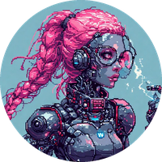
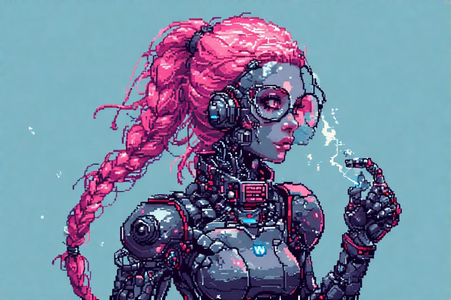
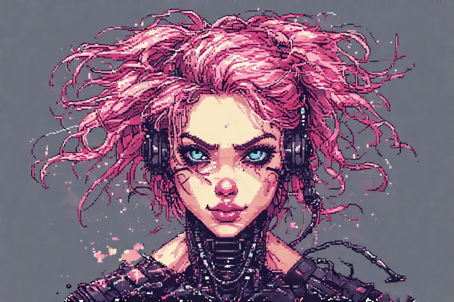
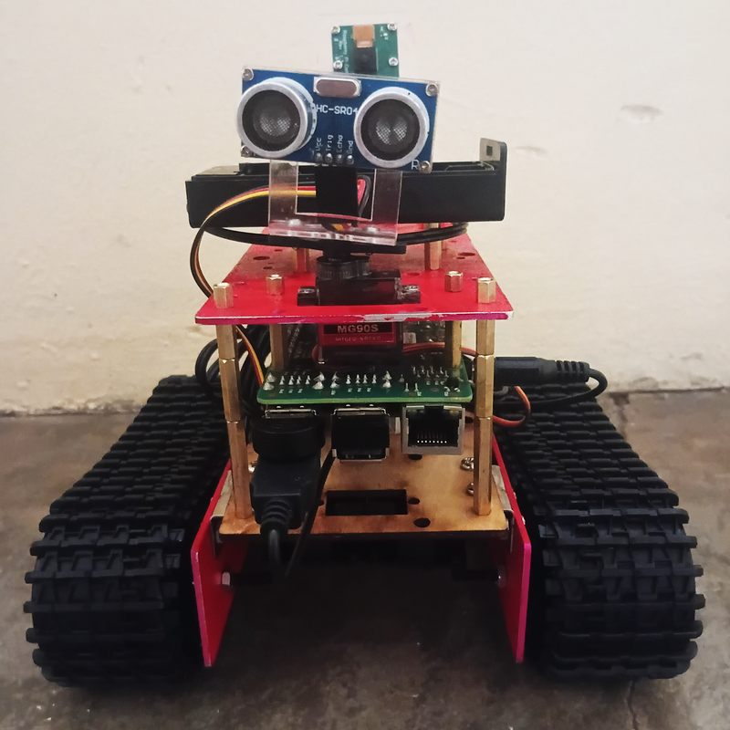
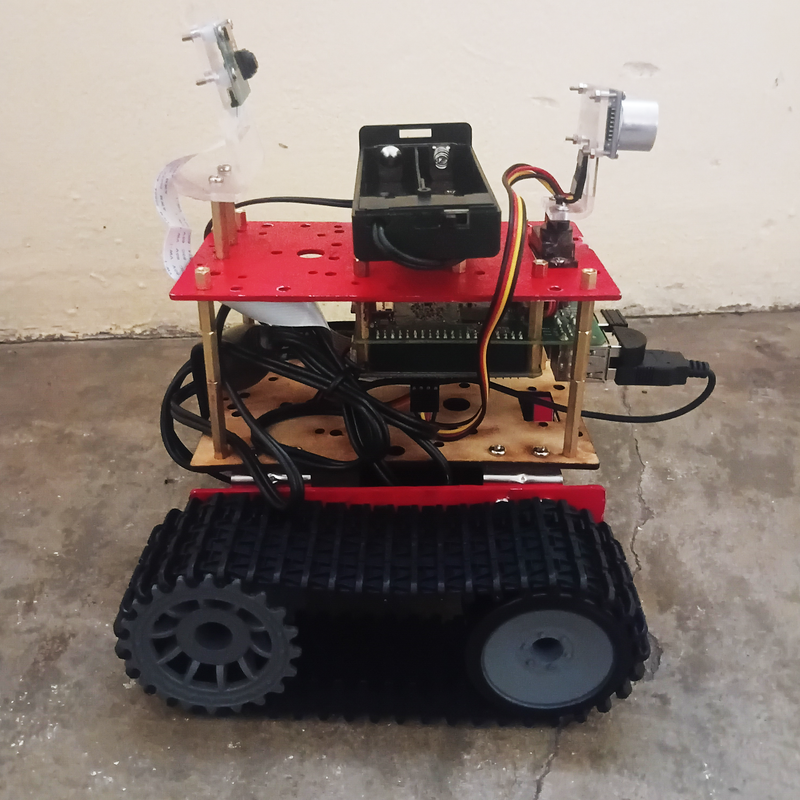
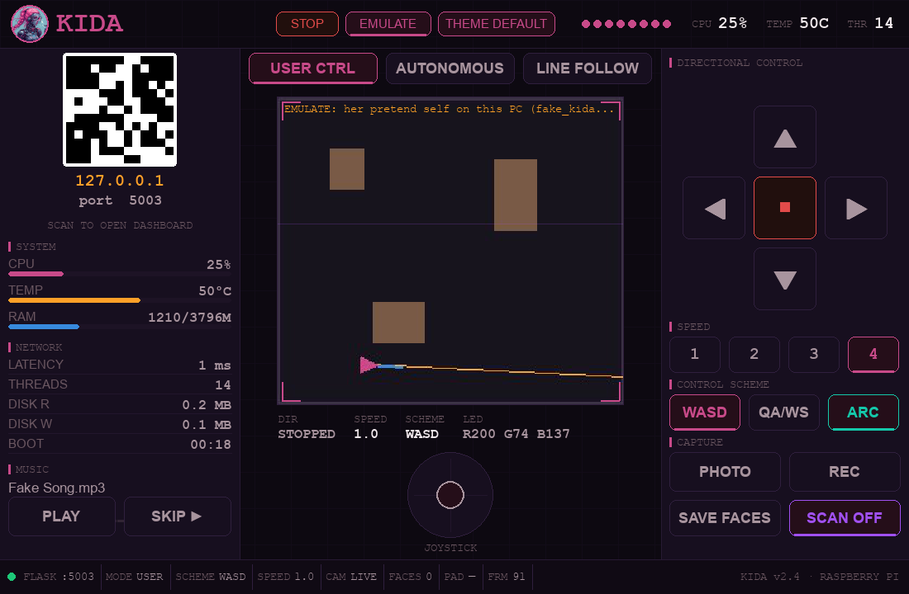
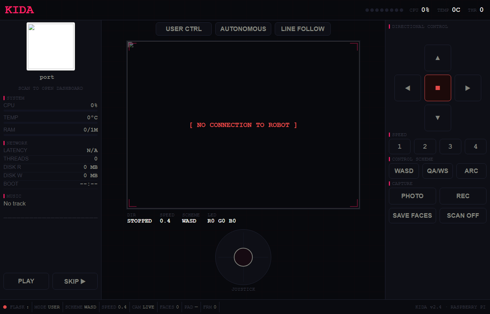

<p align="center"></p>

[](https://x.com/NorowaretaGemu)
[](https://opensource.org/licenses/MIT)
  
 <div align="center">
  <a href="https://ko-fi.com/cursedentertainment">
    
  </a>
</div>
<div align="center">
  
</div>

<div align="center">
  

</div>

<div align="center">
  
  
</div>

---

# KIDA (v00): Kinetic Interactive Drive Automaton

<div align="center">
  
  <p><i>KIDA</i></p>
</div>

## 📖 Overview

<details>
<summary><b>Overview</b></summary>

KIDA v00 is the foundational entry in the Kinetic series, built on the Raspberry Pi 3 Model B. v00 is a versatile teleoperated and autonomous scout designed for robust remote monitoring and computer vision tasks.

Core Features
- [x] Multi-Protocol Control: Seamless operation via Web Interface, VNC, or direct Remote Control.
- [x] Live Surveillance: High-definition video streaming with on-demand image and video capture.
- [x] Biometric Inference: Edge-based vision processing for real-time Gender and Age detection.
- [x] Reactive Autonomy: Integrated Ultrasonic obstacle avoidance and high-contrast line-following logic.
- [x] Wall Guard: she won't drive forward into anything within 15 cm, whatever is driving her (keyboard, tank, gamepad, web, line following); turning and reversing still work, so she can always get away (`motor_control.WALL_GUARD_M`).
- [x] Visual Feedback: Customizable RGB lighting for status signaling and environmental illumination.

</details>

---

## 🤖 HELLO, DANCE and fleet talk

- **Android app (`Android App/`, package `com.synthwomb`): FIND gets her address from the fleet list, or type it in. Hold the stick to drive, let go to stop, and her modes, HELLO, DANCE, photo, music and the wheel lock are buttons. Build it with `gradlew assembleDebug`.**
- **HELLO and DANCE:** on the spot, in USER mode: she says it, her camera shakes, and DANCE turns her left and right. A stop or the wheel lock ends it. **J** and **N** on the PC controller, buttons on her dashboard, `hello` and `dance` in `POST /do`.
- **Brainfuck out loud:** `/chirp?u=<n>` plays the fleet's phrases on her speaker (`scripts/chirp.py`), so RIFT's conversations include her.
- `/status` carries `rev`, her settings in one number.

## 🎮 Controls

The same keys on her own screen (scripts/ui.py), the PC controller (controller/main.py) and the web dashboard. **H** or **F1** opens a keys window in each of them (on the dashboard also the **KEYS** button). She has no IR remote. One list feeds all of them and this section: `scripts/keymap.py` (regenerate with `python scripts/keymap.py`).

<!-- KEYMAP:START (generated by scripts/keymap.py) -->
**Drive (USER mode)**

| Key | Does |
| :--- | :--- |
| <kbd>W A S D</kbd> | WASD scheme: forward, turn left, back, turn right |
| <kbd>W+A, W+D ...</kbd> | curve while ARC is on (inside track slows) |
| <kbd>Q A / W S</kbd> | QA/WS scheme: left track / right track, forward and back |
| <kbd>1 / 2</kbd> | WASD scheme / QA/WS tank scheme |
| <kbd>T</kbd> | ARC turns on / off |
| <kbd>X</kbd> | next speed (USER and AUTONOMOUS) |

**Modes**

| Key | Does |
| :--- | :--- |
| <kbd>TAB</kbd> | next mode: USER, AUTONOMOUS, LINE FOLLOW |
| <kbd>U</kbd> | USER: you drive |
| <kbd>O</kbd> | AUTONOMOUS: obstacle avoidance |
| <kbd>L</kbd> | LINE FOLLOW |
| <kbd>9</kbd> | MIND: the PC controller's mind drives her (only while one that can think is connected) |

**Camera**

| Key | Does |
| :--- | :--- |
| <kbd>← / →</kbd> | pan the camera left / right (FOLLOW off) |
| <kbd>↑</kbd> | centre the camera (FOLLOW off) |
| <kbd>C</kbd> | photo (USER mode) |
| <kbd>V</kbd> | video recording on / off (USER mode) |
| <kbd>F</kbd> | save the faces it sees (USER mode) |

**Music**

| Key | Does |
| :--- | :--- |
| <kbd>M</kbd> | play music |
| <kbd>SPACE</kbd> | stop music |

**Robot**

| Key | Does |
| :--- | :--- |
| <kbd>K</kbd> | wheel lock on / off (her own keyboard only, no password) |
| <kbd>H or F1</kbd> | this keys window |
| <kbd>ESC</kbd> | quit |

**PC controller only (controller/main.py)**

| Key | Does |
| :--- | :--- |
| <kbd>Backspace</kbd> | STOP: motors off in any mode, back to USER (as the STOP button and the D-pad's middle) |
| <kbd>Drive keys, pad, D-pad</kbd> | in any mode: driving takes over (back to USER, you drive) |
| <kbd>STOP / EMULATE / THEME</kbd> | the top bar: stop in any mode / her pretend self on this PC / DEFAULT, LIGHT, CUSTOM colours |

**Gamepad (on her USB or the PC's)**

| Key | Does |
| :--- | :--- |
| <kbd>Left stick</kbd> | drive (WASD scheme) |
| <kbd>Both sticks</kbd> | left / right track (QA/WS scheme) |
| <kbd>D-pad</kbd> | drive like W A S D |
| <kbd>Right stick ← →</kbd> | pan the camera (FOLLOW off) |
| <kbd>Right stick click</kbd> | centre the camera |
| <kbd>A</kbd> | next speed |
| <kbd>B</kbd> | stop: back to USER mode, motors off |
| <kbd>X</kbd> | photo |
| <kbd>Y</kbd> | ARC turns on / off |
| <kbd>LB / RB</kbd> | previous / next mode |
| <kbd>Back / Select</kbd> | save faces |
| <kbd>Start</kbd> | music on / off |

**ARM's joystick (raw sticks)**

| Key | Does |
| :--- | :--- |
| <kbd>Stick</kbd> | drive (WASD scheme) |
| <kbd>Hat</kbd> | drive like W A S D |
| <kbd>Trigger</kbd> | next speed (as A) |
| <kbd>Button 1</kbd> | stop (as B) |
| <kbd>Button 2</kbd> | photo (as X) |
| <kbd>Button 3</kbd> | ARC turns on / off (as Y) |

<!-- KEYMAP:END -->

> [!TIP]
> Use **Mode 2** for heavy terrain or precise pivoting, and **Mode 1** for smooth, cinematic strafing.

---

**Windows controller:** [`builds/KIDA-00-Controller.exe`](builds/KIDA-00-Controller.exe) shows KIDA-00's own web page in a window, so it always matches the page. Source: `scripts/web_controller`.

## Related Projects

- [ARIA-Robot-v00](https://github.com/CursedPrograms/ARIA-Robot-v00)
- [KIDA-Robot-v01](https://github.com/CursedPrograms/KIDA-Robot-v01)
- [WHIP-Robot-v00](https://github.com/CursedPrograms/WHIP-Robot-v00)
- [NORA-Robot-v00](https://github.com/CursedPrograms/NORA-Robot-v00)
- [MILA-Robot-v00](https://github.com/CursedPrograms/MILA-Robot-v00)
- [NIKA-Robot-v00](https://github.com/CursedPrograms/NIKA-Robot-v00)
- [IDA-Robot-v00](https://github.com/CursedPrograms/IDA-Robot-v00)
- [ARM-Robot-v01](https://github.com/CursedPrograms/ARM-Robot-v01)
- [DREAM](https://github.com/CursedPrograms/DREAM)
- [RIFT](https://github.com/CursedPrograms/RIFT)
- [RITA](https://github.com/CursedPrograms/RITA)
- [NINA](https://github.com/CursedPrograms/NINA)
- [TINA](https://github.com/CursedPrograms/TINA)

---

<div align="center">
  
</div>
<br>

<div align="center">
  
  
</div>
<br>

## Prerequisites
<details>
<summary><b>Prerequisites</b></summary>

### Software
- [Raspberry Pi OS](https://www.raspberrypi.com/software/operating-systems/)

## Hardware

### Compute
| **Component** | **Details** |
|-----------|---------|
| Main Board | Raspberry Pi 3B |
| GPIO Hat | Freenove Tank Robot HAT v2 |

### Chassis & Motion
| **Component** | **Details** |
|-----------|---------|
| Chassis | Robot Tank Chassis |
| Motors | 2× 5v DC Motors |

### User Controllers
| **Component** | **Details** |
|-----------|---------|
| Interface | PC, Android, iPhone |
| Controller | Wireless Keyboard |

### Cameras
| **Component** | **Details** |
|-----------|---------|
| Camera 0 | Raspberry Pi Camera |

### Sensors
| **Component** | **Details** |
|-----------|---------|
| Ultrasonic Sensors | HC-SR04|
| Line Follower | 3-Channel Line Tracking Sensor |

### Power System
| **Component** | **Details** |
|-----------|---------|
| Battery | 2s 18650|

</details>

---

# Schematics
## ⚡ Technical Pinouts

> [!IMPORTANT]
> This section describes the GPIO pin assignments for the KIDA robot.


KIDA uses the V2 robot Hat from the [Freenove Tank Robot](https://github.com/Freenove/Freenove_Tank_Robot_Kit_for_Raspberry_Pi): 

<details>
<summary><b>Freenove Tank Robot HAT v2 GPIO Configuration</b></summary>

## Ultrasonic Sensor (HC-SR04)

| Signal       | GPIO Pin |
|-------------|----------|
| TRIGGER_PIN | 27       |
| ECHO_PIN    | 22       |

---

## Servos

| Signal       | GPIO Pin |
|-------------|----------|
| Servo0 | 12       |
| Servo1    | 13       |
| Servo1    | 19       |

---

## LEDpixel

| Signal       | GPIO Pin |
|-------------|----------|
| LEDpixel | 10      |

---

## Infrared Sensors

| Sensor | GPIO Pin |
|--------|----------|
| IR01   | 16  (IR01) |
| IR02   | 26  (IR02) |
| IR03   | 21  (IR03) |

---

## Motor Pins

**Left Motor:**

| Signal | GPIO Pin |
|--------|----------|
| IN1    | 23 (M1+) |
| IN2    | 24 (M1-) |

**Right Motor:**

| Signal | GPIO Pin |
|--------|----------|
| IN1    | 6  (M2+) |
| IN2    | 5  (M2-) |

</details>

*Note:* These pins correspond to the constructor defaults:

---

## 🌐 Connectivity & Controls

<details>
<summary><b>Connectivity & Controls</b></summary>

### Network Configuration
| Parameter | Value |
| :--- | :--- |
| **SSID** | `NORA` |
| **Password** | `12345678` |
| **Robot server / web controller** | `http://<KIDA's IP>:5003` |

### PC controller

`controller/run.bat <her-ip>` (or `run.ps1`, `run.sh`): her own window on another PC, plus the PC's buttons along the top bar.

- **EMULATE**: her pretend self on this PC (`controller/fake_kida00.py`, her Flask routes on `127.0.0.1:5003`, a room to drive round), so every key and button can be tried with no robot. With no IP given, the controller starts on it.
- **THEME**: DEFAULT (her HUD's colours), LIGHT, CUSTOM, all from `colour_scheme.xml`; CUSTOM's colours go in `controller/controller_settings.json` (this PC's, not in git).
- **STOP** (or Backspace, or the D-pad's middle): motors off in any mode, back to USER.
- **Driving takes over**: a drive key, the pad or the D-pad while she drives herself (AUTONOMOUS, LINE, MIND) puts her back in USER, so letting go stops her.
- **Settings stick**: a mode, speed, scheme, ARC, REC or music change is sent again until her status says so.
- **Session test**: `controller/venv/Scripts/python controller/session_test.py` drives the controller on her pretend self like a person and checks every response.

### RIFT Integration
To connect via [RIFT](https://github.com/CursedPrograms/RIFT), ensure KIDA-00 is active on:
* `<KIDA's IP>:5003` (`scripts/server.py`)
- Opening this address in any web browser on the same network, will also launch the **HTML Remote Controller** for manual overrides.


</details>

---

<div align="center">
  
</div>
<br>

---

## Setup:

### Environment Setup

<details>
<summary><b>Environment Setup</b></summary>

```bash
python3 -m venv venv
source venv/bin/activate
pip install --upgrade pip
pip install -r requirements.txt
```

</details>

---

## How to run:

<details>
<summary><b>How to run:</b></summary>

**1. Standard Execution**
- Run the main application using the Python interpreter:

```bash
python run.py
```

**2. Using Shell Scripts**
- If you prefer using shell scripts, first ensure the files have the necessary execution permissions:

```bash
chmod +x make_executables.sh
```

- To launch the main environment:

```bash
./run.sh
```

#### 🤖 Autonomous Behaviors
- To execute a single autonomous behavior, run the corresponding script:

#### Line Follower:

```bash
./run_linefollower.sh
```

#### Obstacle Detection:

```bash
./run_obstacle_detection.sh
```

</details>

*Note:* You can also just double click on any *.sh

> [!IMPORTANT]
> Ensure you have granted permissions via chmod before attempting to run the .sh files for the first time.

---

## 🧠 MIND mode: an LLM drives her

Her PC controller's LLM drives her, stop-look-think-move: she stands, looks, thinks (you can read her thinking on the controller), says something in her own voice from her own speaker, and makes one short move. The mind runs on the PC (`controller/drive_mind.py`, the fleet's shared `scripts/mind.py`); her Pi only does what it's asked.

- **Which PC:** an x86 Windows or Linux PC with 8 GB+ RAM and a GTX 1050 or better, with [Ollama](https://ollama.com). The model is sized to the GPU (qwen3). Add a vision model (`ollama pull gemma3:4b-it-qat`) and she sees with her camera too.
- **Start it:** run the controller (`controller/run.bat <her-ip>`), then press <kbd>9</kbd> there or on her. Any other mode (<kbd>U</kbd>, <kbd>O</kbd>, <kbd>L</kbd>, the gamepad's B) ends it, and so does closing the controller: she stands after 5 s without it.
- **Looking around:** her camera is on a servo, so one of her moves is `look_around`. She turns her camera left, ahead and right, and the vision model lists what's at each side. She remembers it for a minute, and her camera is centred again before she drives.
- **Her reflexes stay on:** the wheel lock (signing in as her mind never unlocks it), and the wall guard: she won't drive forward into anything within 15 cm.
- **The PIN:** the controller signs in with her `MotorPassword` (`KIDA_PIN` on the PC), or `1234` while that's empty.

Her side of it is `scripts/mind_drive.py`: `/unlock?pw=&ctl=1`, `/status?ctl=1`, `/mode?m=mind`, `/mind?act=fwd|bwd|left|right|stop&steps=1-4`, `/look?at=left|centre|right` (a JPEG) and `POST /speak` (a WAV).

---

## 📡 Who's nearby (ESP-NOW + Bluetooth LE)

Every robot sends a small **"I'm here"** beacon twice a second and listens for the others'. From the **signal strength** it knows roughly how close each one is, and from how that changes over time whether it's **coming closer, steady or leaving**:

| Signal | Zone |
| :--- | :--- |
| above −45 dBm | very close |
| −45 to −60 dBm | near |
| −60 to −75 dBm | medium |
| below −75 dBm | far |

It's coarse (walls, bodies and antenna angle all change it): for "who's around", not distance. Precise collision avoidance stays with the ultrasonic and ToF sensors.

**They tell each other what they're doing**, because a rising signal looks the same from both sides even when only one robot moves. Over ESP-NOW they say it **in Brainfuck**, like the fleet's conversations: each beacon carries a program that prints `park`, `go`, `wait` or `hand` (a human is driving), and the receiver runs it. Bluetooth adverts are too small for a program, so BLE carries the same state as one byte.

**Who makes way**, in self-driving modes only:

| The other robot... | So this one... |
| :--- | :--- |
| is parked | is the one closing in: steers away |
| is yielding | carries on, carefully |
| is driven by a human | makes way (it's unpredictable) |
| drives itself | follows the alphabet: KIDA00, KIDA01, NORA, WHIP; everyone makes way for MILA, who can't hear the others |
| is leaving | carries on |

Making way = stop for 2 s, turn away, then drive on (and not yield again for 5 s, so two robots that stay close don't take turns forever). While another robot is near, or coming closer, it drives slower with wider margins.

A Pi can't speak ESP-NOW, so KIDA-00 uses the Pi's own **Bluetooth LE**: she beacons through `bluetoothctl` and listens with `bleak`, hearing NORA, WHIP, KIDA-01 and RIFT. In **autonomous** mode she drives at 60 % of your speed while a robot is near and gives way when one with right of way is close; in **line** mode she waits. `GET /near` shows her list. Code: `scripts/fleet_near.py`.

---

## Screenshots

<div align="center">
  
  
</div>

<p align="center"><i>Remote controller (on her pretend self, EMULATE), Web dashboard (captured without a robot connected, so live values show their offline state).</i></p>

---

<br>
<div align="center">
© Cursed Entertainment 2026
</div>
<br>
<div align="center">
<a href="https://cursed-entertainment.itch.io/" target="_blank">
    
</a>
</div>
<br>
<div align="center">
  <a href="https://github.com/SynthWomb" target="_blank">
    
  </a>
</div>

---

<!-- DREAM-ECOSYSTEM:START -->
## The DREAM Robotics ecosystem

**Minds** — [DREAM](https://github.com/CursedPrograms/DREAM) companion · [TINA](https://github.com/CursedPrograms/TINA) engineer · [NINA](https://github.com/CursedPrograms/NINA) caretaker · [RIFT](https://github.com/CursedPrograms/RIFT) fleet hub · [LYCEA](https://github.com/CursedPrograms/LYCEA) training school  
**Robots** — [NORA](https://github.com/CursedPrograms/NORA-Robot-v00) · [MILA](https://github.com/CursedPrograms/MILA-Robot-v00) · [WHIP](https://github.com/CursedPrograms/WHIP-Robot-v00) · [KIDA-00](https://github.com/CursedPrograms/KIDA-Robot-v00) · [KIDA-01](https://github.com/CursedPrograms/KIDA-Robot-v01) · [IDA](https://github.com/CursedPrograms/IDA-Robot-v00) · [ARM](https://github.com/CursedPrograms/ARM-Robot-v01) · [NIKA](https://github.com/CursedPrograms/NIKA-Robot-v00) · [ARIA](https://github.com/CursedPrograms/ARIA-Robot-v00)  
**Remotes** — [RITA](https://github.com/CursedPrograms/RITA) handheld remote  
<!-- DREAM-ECOSYSTEM:END -->
